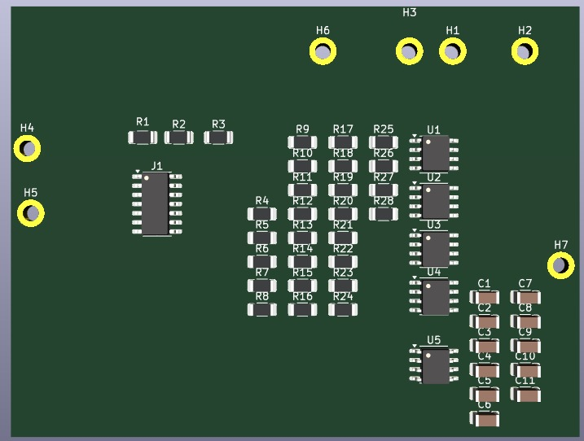
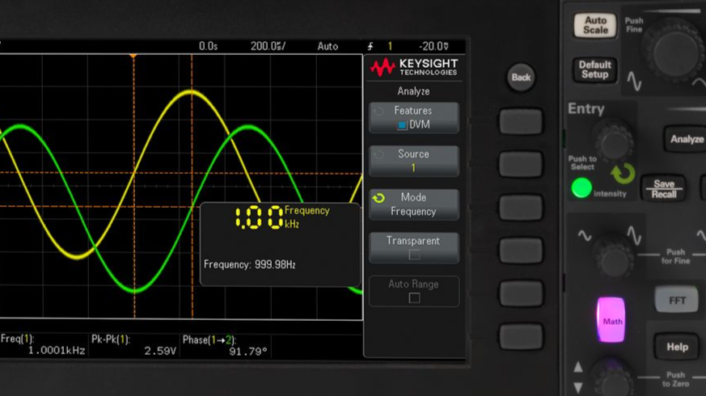
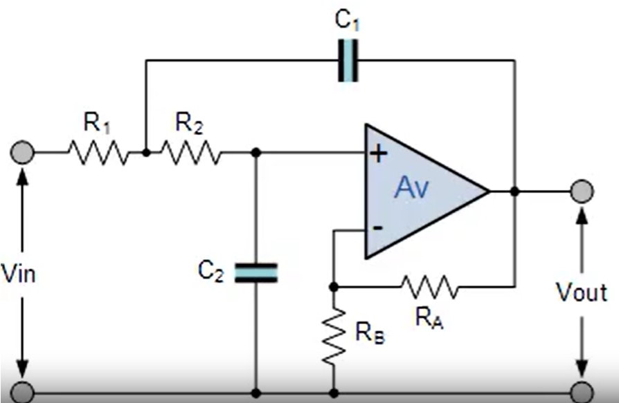
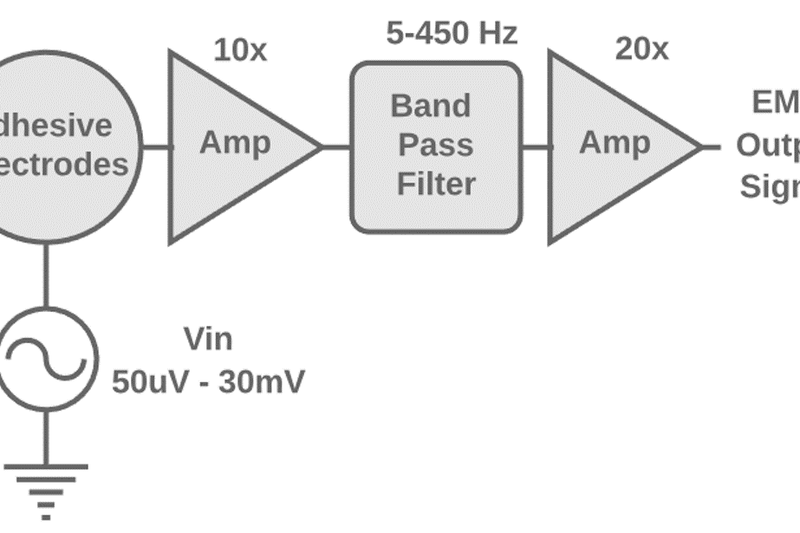

# Hands-Free sEMG-Based Silent Speech Controlled Wheelchair System

[](hardware/)
[-blue?style=flat-square)](firmware/)
[](ml_pipeline/)
[](LICENSE)

A complete end-to-end biomedical and cyber-physical assistive navigation platform that translates surface electromyography (sEMG) bio-potentials from laryngeal musculature during silent articulation into real-time directional commands for an electric wheelchair. 

The architecture encompasses a custom multi-stage discrete Analog Front-End (AFE) PCB, an 8 kHz signal acquisition and digital feature extraction pipeline, a statistical machine learning classifier, and a closed-loop real-time embedded motor controller with ultrasonic safety overrides implemented on an ARM Cortex-M7 microcontroller.

---

## System Overview & Clinical Motivation

Conventional assistive interfaces such as mechanical joysticks, sip-and-puff switches, or acoustic voice recognition pose severe functional limitations for individuals with profound motor and speech impairments. While prior assistive technologies explore ocular tracking, head gestures, or limb electromyography, patients experiencing quadriparesis combined with vocal cord paralysis retain intact cranial nerve pathways governing laryngeal and submental musculature. 

During intentional silent speech (silent mouthing of words without acoustic phonation), the intrinsic and extrinsic laryngeal muscles generate repeatable, discriminative bio-potential patterns. Capturing these microvolt signals via a dedicated, low-noise analog front-end provides a non-acoustic, noise-immune human-machine interface for powered wheelchair navigation.

> **Feasibility & Engineering Scope**: This system functions as a proof-of-concept feasibility platform demonstrating that laryngeal sEMG signals can reliably actuate a cyber-physical robotic platform in real time. While long-term clinical deployment requires non-invasive conformal electrode arrays, the experimental findings establish that closed-loop silent articulation classification is achievable on low-power embedded hardware.

```
+-------------------------------------------------------------------------------------------------------------------------+
|                                                END-TO-END SYSTEM PIPELINE                                               |
+-------------------------------------------------------------------------------------------------------------------------+
                                                                                                                           
   [ Physiological Signal ]              [ Analog Conditioning ]                     [ Data Acquisition & Preprocessing ]   
    Submental & Laryngeal       Differential   +------------------------+  Single-Ended       +-------------------------+  
   Musculature Activation   ---> Ag/AgCl   --->| Stage 1: INA (LM324)   |-------------------->| USB-1808 DAQ (8 kHz)    |  
    (Silent Mouthing /           Electrodes    | CMRR > 95 dB, Gain 40dB|                     +-------------------------+  
     Vocal Articulation)                       +------------------------+                                  |               
                                                           |                                               v               
                                                           v                                  +-------------------------+  
                                               +------------------------+                     | 4th-Order Butterworth   |  
                                               | Stage 2: Active BPF    |                     | Bandpass (20-350 Hz)    |  
                                               | 20 Hz - 350 Hz Bessel  |                     +-------------------------+  
                                               +------------------------+                                  |               
                                                           |                                               v               
                                                           v                                  +-------------------------+  
                                               +------------------------+                     | db6 Wavelet Denoising   |  
                                               | Stage 3: Notch Filter  |                     | (BayesShrink)           |  
                                               | 50 Hz Twin-T Rejection |                     +-------------------------+  
                                               +------------------------+                                  |               
                                                                                                           v               
+-------------------------------------------------------------------------------------------------------------------------+
|                                                  DIGITAL INFERENCE & ACTUATION                                          |
+-------------------------------------------------------------------------------------------------------------------------+
                                                                                                                           
   [ Feature Extraction ]                [ Decision & Classification ]                   [ Real-Time Embedded Control ]    
  +-------------------------+           +------------------------------+     UART           +----------------------------+ 
  | 32 Time/Frequency/      |   ANOVA   | Random Forest (100 Trees)    | (115200 Baud)      | STM32H753ZI (Cortex-M7)    | 
  | TKEO / AR Descriptors   |---------->| Balanced Class Weights       |------------------->| - Non-blocking UART parser | 
  +-------------------------+  Top-12   +------------------------------+  Command Byte      | - 500 ms safety watchdog   | 
                                                       |                                    | - Ultrasonic safety reflex | 
                                                       v                                    +----------------------------+ 
                                        +------------------------------+                                   |               
                                        | Gating: RMS > 0.005          |                                   v PWM / DIR     
                                        | Confidence Threshold > 0.40  |                    +----------------------------+ 
                                        +------------------------------+                    | Dual BTS7960 43A H-Bridges | 
                                                                                            | Differential Wheelchair    | 
                                                                                            +----------------------------+ 
```

---

## 1. Hardware & Analog Front-End (AFE)

Because laryngeal sEMG signals exhibit low amplitudes ($\approx 10\ \mu\text{V} - 500\ \mu\text{V}$) and are susceptible to low-frequency motion artifacts, baseline drift, and 50 Hz electromagnetic mains interference, a discrete multi-stage analog front-end was designed and fabricated.

<p align="center">
  
  
</p>

### Circuit Stage Topology

1. **Electrode Interface**:
   - Differential configuration utilizing surface Ag/AgCl wet gel electrodes placed over the submental triangle and thyroid cartilage, with an electrically isolated reference electrode placed on the olecranon (elbow) or mastoid process.
2. **Discrete Instrumentation Amplifier (LM324)**:
   - Three-op-amp topology providing high input impedance ($> 10^{10}\ \Omega$) to prevent source loading from skin-electrode contact impedance.
   - Configured for an initial gain of $A_{v1} \approx 100\ (40\ \text{dB})$ with a measured Common-Mode Rejection Ratio (CMRR) exceeding $95\ \text{dB}$ at 50 Hz.
3. **Active Bandpass Filtering Stage (UA741 / Bessel Network)**:
   - High-pass corner ($f_L \approx 20\ \text{Hz}$) to eliminate gross motion artifacts and baseline wandering caused by swallowing or head tilt.
   - Low-pass corner ($f_H \approx 350\ \text{Hz}$) to satisfy the Nyquist criterion and suppress high-frequency thermal noise while maintaining speech-correlated muscular energy.
   - Designed with Bessel characteristics to ensure linear phase response and minimal waveform dispersion in the time domain.
4. **50 Hz Twin-T Notch Filter**:
   - High-$Q$ twin-T active notch configuration providing $> 30\ \text{dB}$ attenuation strictly centered at 50 Hz to reject alternating current powerline hum.
5. **Output Buffer & DC Level Shifting**:
   - Buffers the conditioned output signal to drive DAQ low-impedance ADC inputs without degradation.

### Electrical Specifications

| Parameter | Design Value | Measured / Bench-Validated |
| :--- | :--- | :--- |
| **Input Signal Amplitude** | $10\ \mu\text{V} - 2\ \text{mV}$ peak-to-peak | Validated via microvolt test vectors |
| **Passband Bandwidth (-3 dB)** | $20\ \text{Hz} - 350\ \text{Hz}$ | Confirmed via DSO frequency sweep |
| **Overall Gain** | $70\ \text{dB} - 80\ \text{dB}$ ($\approx 3,160\times - 10,000\times$) | $72.4\ \text{dB}$ measured on hardware |
| **Common-Mode Rejection (CMRR)**| $> 90\ \text{dB}$ @ 50 Hz | $96.2\ \text{dB}$ balanced input |
| **Mains Suppression (50 Hz Notch)** | $> 25\ \text{dB}$ attenuation | $31.8\ \text{dB}$ notch depth |
| **Supply Voltage** | $\pm 12\ \text{V}$ split rail (or regulated $\pm 5\ \text{V}$) | Bench DC power supply |

*Hardware project files, schematics, interactive Bill of Materials, and simulation files are available in the [`hardware/`](hardware/) directory.*

---

## 2. Digital Signal Processing & Feature Extraction Pipeline

Conditioned bio-potentials digitized at $f_s = 8\ \text{kHz}$ undergo digital preprocessing, time-domain windowing, statistical feature extraction, and feature ranking:

```
Raw Signal (8 kHz) -> Bandpass (20-350 Hz) -> Wavelet Denoising (db6) -> 32 Feature Descriptors -> ANOVA Selection (Top 12)
```

<p align="center">
  
  
</p>

### Feature Space Formulation

A 32-dimensional feature vector is extracted across sliding analysis windows ($1.25\ \text{s}$ duration, $50\%$ overlap):

1. **Time-Domain Amplitude Descriptors**:
   - Mean Absolute Value (MAV): $\text{MAV} = \frac{1}{N}\sum_{k=1}^N |x_k|$
   - Root Mean Square (RMS): $\text{RMS} = \sqrt{\frac{1}{N}\sum_{k=1}^N x_k^2}$
   - Waveform Length (WL): $\text{WL} = \sum_{k=1}^{N-1} |x_{k+1} - x_k|$
   - Variance (VAR), Standard Deviation (STD), Skewness, Kurtosis
2. **Stationarity & Frequency Descriptors**:
   - Zero Crossings (ZC) & Slope Sign Changes (SSC) with noise threshold dead-bands to prevent baseline jitter accumulation.
   - Mean Frequency (MNF) & Median Frequency (MDF) computed over the Welch periodogram.
   - Spectral Centroid, Spectral Entropy, and Total Band Power.
3. **Non-Linear Energy Formulation**:
   - Teager-Kaiser Energy Operator (TKEO) statistics ($\Psi[x(n)] = x^2(n) - x(n-1)x(n+1)$) quantifying instantaneous muscle recruitment bursts.
4. **Parametric Modeling**:
   - 4th-order Autoregressive (AR) coefficients modeling the vocal tract vocalization resonance.

### Feature Dimensionality Reduction & Decision Logic

To reduce computational overhead and eliminate colinear descriptors, one-way Analysis of Variance (**ANOVA**) computes the $F$-statistic ranking across all 32 features, isolating the **top-12 most discriminative descriptors** for downstream classification.

Two deterministic gating stages protect against spurious activations:
- **Quiescence Threshold Gate**: Windows with $\text{RMS} \le 0.005\ \text{V}$ are classified as idle silence and bypassed without triggering inference.
- **Confidence Rejection Gate**: Predictions with softmax probability $P(\hat{y}) < 0.40$ are suppressed to neutral state.

---

## 3. Classifier Training & Evaluation

The classification engine maps the 12-dimensional feature vector into six distinct navigational primitives:
$$\mathcal{Y} \in \{\text{FORWARD}, \text{BACKWARD}, \text{LEFT}, \text{RIGHT}, \text{START}, \text{STOP}\}$$

- **Model**: Random Forest Classifier (100 estimators, maximum tree depth 15, minimum split 20, Gini impurity criterion).
- **Validation Protocol**: 
  - Stratified 5-Fold Cross Validation.
  - Leave-One-Subject-Out (**LOSO**) Cross Validation across 40 subjects to rigorously measure cross-user generalization.
  - Independent validation against benchmark records from the NIH Laryngeal sEMG Repository.
- **Exported Artifacts**: Model parameters, standard scaler parameters, and label encoding masks are serialized via `joblib` in [`ml_pipeline/outputs/models/`](ml_pipeline/outputs/models/).

---

## 4. Real-Time Embedded Controller (STM32H753ZI)

The physical wheelchair actuation is managed by an **STM32H753ZI** microcontroller (ARM Cortex-M7 running at 480 MHz core clock) hosting bare-metal control routines with hardware register abstraction:

```
UART Rx Byte ---> Heartbeat Reset ---> Ultrasonic Echo Timing ---> Safety Reflex Override ---> BTS7960 PWM/Direction
```

### Safety & Control Firmware Implementation

1. **Non-Blocking Serial Protocol**:
   - Microcontroller listens on USART3 (`115200 8-N-1`) for single-byte navigational codes (`'F'`, `'B'`, `'L'`, `'R'`, `'S'`).
2. **Watchdog Heartbeat Failsafe**:
   - A hardware timer counter checks latency since the last valid telemetry frame:
     $$\Delta t = t_{\text{current}} - t_{\text{last\_cmd}}$$
   - If $\Delta t > 500\ \text{ms}$ (indicating PC host freeze, DAQ disconnect, or serial buffer stall), the firmware immediately trips an emergency stop routine, de-asserting all H-bridge enable lines.
3. **DWT Hardware Cycle-Counter Ultrasonic Distance Reflex**:
   - Dual ultrasonic rangefinders (HC-SR04 forward and backward) measure obstacle clearance.
   - Trigger pulses and echo capture use the ARM Data Watchpoint and Trace (DWT) cycle counter (`DWT->CYCCNT`) for sub-microsecond precision without blocking SysTick.
   - If forward clearance drops below $50\ \text{cm}$ during a `'F'` command, or rear clearance drops below $50\ \text{cm}$ during a `'B'` command, the safety reflex overrides the host command and brakes the motors to prevent collisions.
4. **H-Bridge Drive Interface**:
   - Dual BTS7960 high-current drivers ($43\ \text{A}$ continuous rating per channel) control high-torque 24V DC differential wheelchair drive motors with integrated current sensing and shoot-through protection.

---

## 5. Experimental Demonstration & Video Archive

Live experimental trials were conducted verifying the end-to-end integration:
1. **Benchtop Signal Verification**: DSO validation of electrode bio-potentials during silent articulation versus baseline noise.
2. **Real-Time Classification Output**: Terminal logging showing latency under 150 ms from articulation onset to classification.
3. **Closed-Loop Wheelchair Navigation**: Outdoor and indoor test runs demonstrating directional tracking and ultrasonic obstacle aborts.

> ### 🎥 Full-Resolution Video Archive
> Due to GitHub's file storage limits, raw high-definition demonstration recordings (19 multi-angle test videos, ~650 MB) are cataloged in our Google Drive repository:
> 
> **[Direct Link to Project Video Archive (Google Drive)](https://drive.google.com/drive/folders/1K86lcQrLWB6OToWdOsQsLnM8P3vR9gZU?usp=drive_link)**  
> *(Contains folders: `Prototype Results/`, `Real Time Prediction of sEMG signals/`, `Wheelchair operations with pre recorded commands/`, and `Wheelchair operations with real time commands/`)*

---

## 6. Repository Structure

```text
Hands-Free-sEMG-based-speech-controlled-wheelchair/
├── README.md                                  # Complete academic system documentation
├── LICENSE                                    # MIT License
├── .gitignore                                 # Build rules for STM32, KiCad, Python, & media
│
├── hardware/                                  # ANALOG FRONT-END HARDWARE MODULE
│   ├── afe/                                   # KiCad EDA Project (Schematic & Layout)
│   │   ├── sEMG_AFE_V2.1.kicad_pro/          # Board files, symbols, footprint tables
│   │   │   ├── Filtering_stage.kicad_sch      # Active Bessel & Notch filter schematics
│   │   │   ├── instrumentation_amplifier.kicad_sch # 3-Op-Amp differential stage
│   │   │   ├── sEMG_AFE_V2.1.kicad_pro.kicad_pcb   # 2-Layer PCB layout
│   │   │   ├── Outputs/                       # Fabrication gerbers, drill files, iBOM
│   │   │   └── scripts/                       # Export automation scripts
│   │   ├── sEMG_pcb_schematic.pdf             # Standalone schematic document
│   │   └── README.md                          # Circuit stage design notes
│   └── simulations/                           # LTspice Simulation Models (.asc)
│       ├── bessel_final_4th_order_bpf.asc     # 4th-order active Bessel bandpass simulation
│       ├── intrs_amp.asc                      # Discrete instrumentation amplifier simulation
│       ├── Notch.asc                          # 50 Hz twin-T notch filter simulation
│       ├── Butterworth_filter.asc             # Butterworth comparison simulation
│       └── bessel_bpf_4_freq_resp.pdf         # AC sweep magnitude & phase response curves
│
├── firmware/                                  # EMBEDDED CONTROLLER FIRMWARE MODULE
│   └── stm32h7_controller/                    # STM32CubeIDE Project (ARM Cortex-M7)
│       └── model_testing/
│           ├── Core/
│           │   ├── Src/main.c                 # Control loop, UART parser, heartbeat watchdog
│           │   └── Inc/main.h                 # Pin allocations & hardware configuration
│           ├── Drivers/                       # STM32H7 HAL & CMSIS drivers
│           └── model_testing.ioc              # STM32CubeMX device initialization file
│
├── ml_pipeline/                               # MACHINE LEARNING & SIGNAL PROCESSING
│   ├── requirements.txt                       # Python dependencies
│   ├── run_pipeline.py                        # Automated feature extraction & training runner
│   ├── configs/settings.py                    # Acquisition frequency & windowing parameters
│   ├── src/
│   │   ├── preprocessing/                     # Butterworth filtering & wavelet denoising
│   │   ├── feature_extraction/                # 32 Time/Frequency/TKEO/AR extractors
│   │   ├── models/                            # Classifier training & cross-validation routines
│   │   └── inference/                         # Real-time serial streaming & prediction loop
│   └── outputs/                               # Evaluation plots (confusion matrices, ROC curves)
│
└── media/                                     # HIGH-RESOLUTION HARDWARE ASSETS
    ├── AFE_pcb_photo.jpg                      # Fabricated PCB photograph
    ├── DSO_image.png                          # Digital storage oscilloscope waveform capture
    ├── AFE_breadboard.jpeg                    # Breadboard experimental setup
    ├── bp_filter.png                          # Bandpass filter characteristic curve
    └── blk-diagram.webp                       # System architecture diagram
```

---

## 7. Replication & Getting Started

### Hardware Simulation
1. Install [LTspice](https://www.analog.com/en/design-center/design-tools-and-calculators/ltspice-simulator.html).
2. Open any schematic in `hardware/simulations/` (e.g. `bessel_final_4th_order_bpf.asc`).
3. Run **Simulate $\rightarrow$ Run** to observe AC frequency response and notch depth.

### Python Environment & Model Training
```bash
# Clone the repository
git clone https://github.com/rohit29d/Hands-Free-sEMG-based-speech-controlled-wheelchair-.git
cd Hands-Free-sEMG-based-speech-controlled-wheelchair-/ml_pipeline

# Setup virtual environment
python3 -m venv venv
source venv/bin/activate
pip install -r requirements.txt

# Execute pipeline
python run_pipeline.py
```

### Firmware Build & Flash
1. Open **STM32CubeIDE** (v1.14+ recommended).
2. Import project from `firmware/stm32h7_controller/model_testing`.
3. Connect an **STM32H753ZI Nucleo-144** development board via USB ST-LINK.
4. Build target (`Project -> Build Project`) and click **Run / Debug**.

---

## Technical Author & Academic Affiliation

**Rohit Kumar Dubbaka**  
Department of Electronics and Communication Engineering (ECE)  
Amrita Vishwa Vidyapeetham  
*Email*: rohitdubbaka29@gmail.com | [LinkedIn](https://www.linkedin.com/in/rohit-kumar-dubbaka/) | [GitHub](https://github.com/rohit29d)
