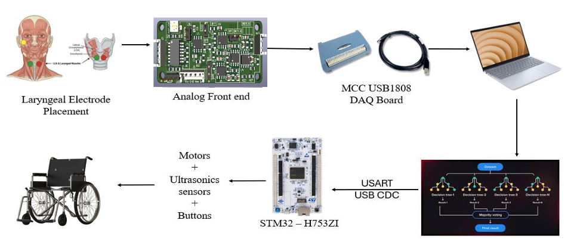
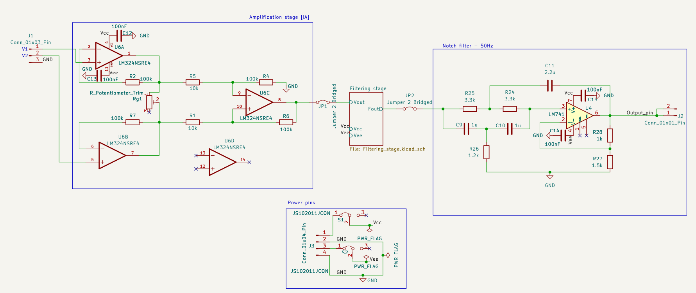
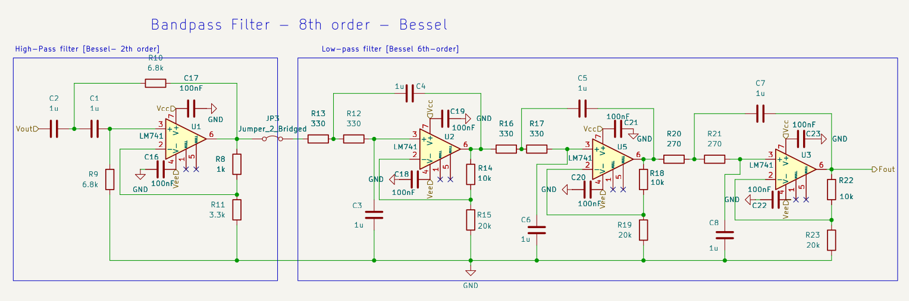
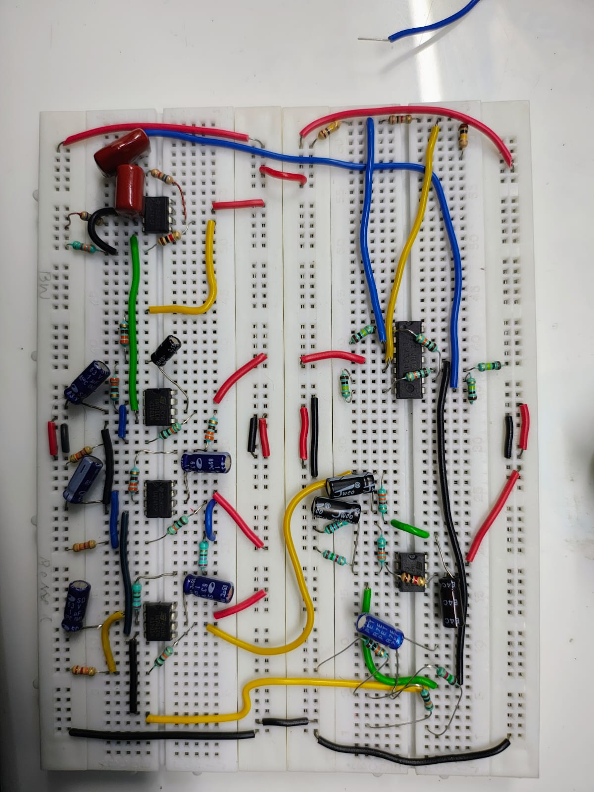
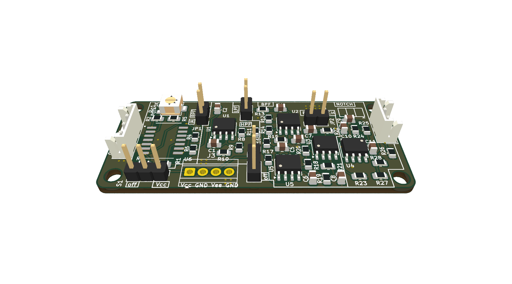
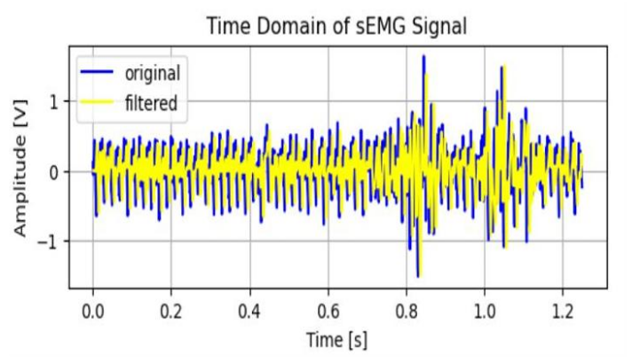
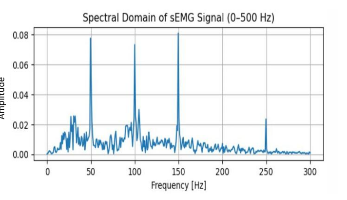
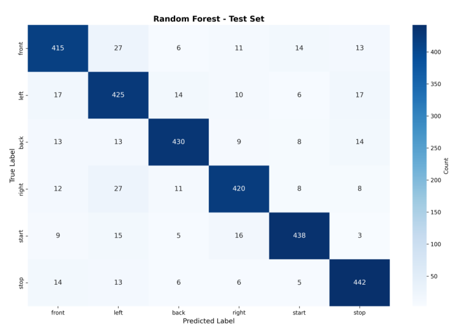

# Hands-Free sEMG-Based Silent Speech Controlled Wheelchair System

[](hardware/)
[-blue?style=flat-square)](firmware/)
[](ml_pipeline/)
[-blue?style=flat-square)](ml_pipeline/)
[](LICENSE)

> **Academic Notice**: This repository documents undergraduate capstone thesis research conducted at Amrita School of Engineering (March 2026). A formal manuscript publication currently in progress. All materials are shared for admissions review and non-commercial academic evaluation. For collaborative research access or hardware replication inquiries, please contact the author.


A complete end-to-end biomedical cyber-physical assistive system translating non-auditory surface electromyography (sEMG) bio-potentials from laryngeal musculature into real-time directional commands for an electric wheelchair. 

The architecture encompasses a custom multi-stage discrete Analog Front-End (AFE) PCB, an 8 kHz signal acquisition and digital feature extraction pipeline, a Bayesian-optimized Random Forest classifier, and a real-time embedded motor controller with ultrasonic safety interrupts implemented on an ARM Cortex-M7 microcontroller.

---

## System Overview & Clinical Motivation

Conventional assistive interfaces such as mechanical joysticks, sip-and-puff switches, or acoustic voice recognition present severe operational constraints for individuals with profound motor and speech impairments (e.g., Amyotrophic Lateral Sclerosis, locked-in syndrome, quadriplegia). While prior systems investigate ocular tracking, head gestures, or limb electromyography, individuals with advanced quadriplegia combined with vocal cord impairment retain intact cranial nerve pathways governing laryngeal and submental musculature.

During silent articulation (mouthing navigation words without acoustic vocalization), intrinsic and extrinsic laryngeal muscles produce repeatable neuromuscular bio-potentials. Capturing these microvolt signals via a dedicated, low-noise analog front-end provides an acoustic-noise-immune human-machine interface for powered wheelchair navigation.

> **Feasibility & Engineering Scope**: This system serves as a proof-of-concept feasibility platform demonstrating that laryngeal sEMG signals can reliably actuate an electric wheelchair in real time. While clinical adoption warrants non-invasive conformal electrode housings, this work proves that closed-loop silent articulation classification is achievable on embedded microcontroller hardware.

```
+-------------------------------------------------------------------------------------------------------------------------+
|                                                END-TO-END SYSTEM PIPELINE                                               |
+-------------------------------------------------------------------------------------------------------------------------+
```

<p align="center">
  
</p>
---

## 1. Hardware & Analog Front-End (AFE)

Laryngeal sEMG signals exhibit low amplitudes ($\approx 10\ \mu\text{V} - 500\ \mu\text{V}$) and are highly vulnerable to motion artifacts, electrode polarization drift, and 50 Hz electromagnetic power-line interference. A dedicated 3-stage analog front-end was designed, simulated in LTspice, and fabricated as a compact 2-layer PCB.

<p align="center">
  
  
</p>

### Circuit Topology & Component Selection

1. **Electrode Configuration**:
   - Differential 3-electrode montage using clinical-grade Ag/AgCl wet gel patches: two electrodes placed over the submental and ventromedial laryngeal muscles (thyrohyoid and sternohyoid) and a reference electrode placed on the cheekbone to establish a stable body ground.
2. **Discrete Instrumentation Amplifier (LM324)**:
   - Three-op-amp instrumentation topology chosen for high input impedance ($> 10^{10}\ \Omega$) to prevent signal attenuation from skin-electrode contact impedance.
   - Comparative operational amplifier testing across LM324, LM348, LM386, and $\mu\text{A}741$ established **LM324** as the optimal candidate due to its minimal output offset voltage of **0.199 mV** at high gain ($A_v = 1001$).
   - Implemented with 1% metal film resistors ($R_2, R_4 = 100\ \text{k}\Omega$, $R_1, R_3 = 10\ \text{k}\Omega$, $R_{\text{gain}} = 1\ \text{k}\Omega$) providing a Common-Mode Rejection Ratio (CMRR) designed for **100 dB**.
3. **Active Bandpass Filter Stage**:
   - Cascaded 20 Hz high-pass and 300 Hz low-pass sections in a Multiple Feedback / KRC topology forming a **6th-order Bessel filter**.
   - Bessel characteristics were selected over Butterworth and Chebyshev to achieve a maximally linear phase response and constant group delay, preserving the time-domain morphology of sEMG muscle bursts.
4. **50 Hz Twin-T Active Notch Filter**:
   - High-$Q$ band-reject KRC active filter providing sharp attenuation strictly centered at 50 Hz to reject power-line interference.
5. **Physical PCB Implementation**:
   - Compact 2-layer board measuring **6 cm × 2.5 cm**, routed with 0.2 mm signal traces and 0.3 mm power traces.
   - 0805 SMD components with inter-stage isolation jumpers and diagnostic test points for modular bench validation.
   - Conditioned bio-potentials produce a peak-to-peak output swing of **$\pm 0.8\ \text{V}$**, ready for digitizer ADC interfacing.

<p align="center">
  
</p>
<p align="center">
  
</p>

*Complete KiCad schematics, layouts, interactive BOM, and LTspice simulation models are organized in the [`hardware/`](hardware/) directory.*

---

## 2. Signal Preprocessing & Signal-to-Noise Enhancement

Digitized at $f_s = 8\ \text{kHz}$ via a Measurement Computing USB-1808 DAQ (18-bit resolution, low-latency streaming), the raw non-stationary signals undergo a two-stage software conditioning pipeline:

1. **Adaptive Discrete Wavelet Transform (DWT)**:
   - 6th-level multiresolution decomposition utilizing nearly-symmetric **Daubechies-6 (`db6`)** wavelets to minimize phase distortion.
   - **BayesShrink** data-driven adaptive thresholding applied to detail coefficients to eliminate in-band Gaussian noise.
   - Inverse DWT reconstruction preserves sharp physiological contraction onsets while eliminating high-frequency noise.
2. **Secondary Digital Bandpass**:
   - 4th-order Butterworth digital bandpass filter ($20\ \text{Hz} - 350\ \text{Hz}$) to isolate the low-frequency envelope where speech muscle activation is concentrated.

### Quantitative Noise Reduction Performance

| Metric | Raw Acquired Signal | Post-Denoised Signal | Improvement |
| :--- | :--- | :--- | :--- |
| **Signal-to-Noise Ratio (SNR)** | **2.43 dB** | **10.63 dB** | **+8.20 dB gain** |
| **Signal Morphology** | Heavy baseline drift & Gaussian noise | Clean contraction bursts with smooth envelope | Validated across 60 subjects |

<p align="center">
  
  
</p>

---

## 3. Dataset & Data Augmentation

To ensure generalization across users while compensating for limited patient access, a comprehensive empirical dataset was acquired:

* **Cohort**: **60 human participants** (36 males, 4 females, aged 19–22).
* **Command Vocabulary**: 6 navigational directives: `FRONT`, `BACK`, `LEFT`, `RIGHT`, `START`, and `STOP`.
* **Articulatory Modalities**: Both audible vocalization and completely silent mouthing (words mouthed without acoustic sound).
* **Data Augmentation**: Applied exclusively to the 80% training partition using three random transformations:
  - Time Shifting (up to $\pm 10\%$ duration shift).
  - Time Scaling (duration compression/expansion between $80\% - 125\%$).
  - Frequency Warping via Short-Time Fourier Transform (STFT) to simulate inter-subject muscle conduction velocity differences.
* **Dataset Scale**: **14,598 balanced feature samples** across all 6 classes (80% train: 11,678 samples; 20% held-out test: 2,920 samples).
* **Benchmark Cross-Validation**: Validated against benchmark records from the **NIH Laryngeal sEMG Repository** (NIDCD Grant R15DC015335).

---

## 4. Feature Extraction & Selection

Feature extraction was performed using a **1000 ms sliding window**. A total of **32 distinct physiological descriptors** were computed across three analytical domains:

* **Time-Domain Descriptors**: Mean Absolute Value (MAV), Variance (VAR), Root Mean Square (RMS), Slope Sign Changes (SSC), Zero Crossings (ZC), Waveform Length (WL), Skewness, Kurtosis, Peak-to-Peak Amplitude, Zero-Crossing Rate, Mean, Shape Factor, Impulse Factor, Logarithmic Variance.
* **Frequency-Domain Descriptors**: Peak Frequency, Power Spectral Density (PSD), Band Power, Spectral Roll-Off, Spectral Spread, Mean Frequency (MNF), Median Frequency (MDF), Power Ratio, Spectral Centroid Ratio, Spectral Entropy Concentration, Spectral Entropy, Total Power.
* **Energy & Parametric Descriptors**: Teager-Kaiser Energy Operator statistics (TKEO: MAV, RMS, STD), Sub-band Power Ratios (Low, Mid, High), 4th-order Autoregressive (AR) coefficients.

### Feature Importance via ANOVA
One-way Analysis of Variance (**ANOVA $F$-statistic ranking**) was implemented to evaluate feature separability. While the full 32-feature vector was leveraged for high-accuracy host inference, the ANOVA ranking provides the exact mathematical basis for pruning the feature set down for resource-constrained microcontroller deployment.

---

## 5. Classifier Optimization & Quantitative Results

### Hyperparameter Tuning via Bayesian Optimization
Rather than relying on manual grid search, a **Bayesian Optimization algorithm (`BayesSearchCV`)** was executed over 50 iterations with 3-fold stratified cross-validation to locate the optimal hyperparameter manifold:

| Parameter | Setting / Optimal Value |
| :--- | :--- |
| **Estimators (`n_estimators`)** | 100 |
| **Maximum Depth (`max_depth`)** | 15 |
| **Max Features (`max_features`)** | `sqrt` |
| **Min Samples Split (`min_samples_split`)** | 20 |
| **Min Samples Leaf (`min_samples_leaf`)** | 7 |
| **Bootstrap** | False |

### Held-Out Test Set Performance (Unseen 2,920 Samples)

The optimized Random Forest classifier was evaluated on the completely unseen 20% held-out test partition:

| Navigation Command | Precision | Recall | F1-Score | Support |
| :--- | :---: | :---: | :---: | :---: |
| **FRONT** | 0.86 | 0.85 | 0.86 | 486 |
| **BACK** | 0.82 | 0.87 | 0.84 | 489 |
| **LEFT** | 0.91 | 0.88 | 0.90 | 487 |
| **RIGHT** | 0.89 | 0.86 | 0.88 | 486 |
| **START** | 0.91 | 0.90 | 0.91 | 486 |
| **STOP** | 0.89 | 0.91 | 0.90 | 486 |
| **Overall Model Metrics** | **Accuracy: 88.01%** | **Macro F1: 88.03%** | **3-Fold CV: 84.45% (±1.02%)** | **Total: 2,920** |

<p align="center">
  
</p>

* The model demonstrates balanced diagonal separability across all classes, maintaining high precision ($> 0.89$) on critical navigational commands (`START`, `STOP`, `LEFT`).
* In offline testing across arbitrary pre-recorded streams, the classifier exhibited an average frame consistency of **72%**.

---

## 6. Real-Time Embedded Controller & Safety Architecture

The physical wheelchair actuation is governed by an **STM32H753ZI** microcontroller (ARM Cortex-M7 running at 480 MHz, double-precision FPU, 2 MB Flash, 1 MB RAM with ITCM/DTCM tightly coupled memory for zero-wait-state execution).

```
Serial Telemetry ---> Heartbeat Reset ---> Ultrasonic Echo Timing ---> Interrupt Override ---> BTS7960 Motor Drive
```

### Real-Time Inference & Gating Protocol

1. **"Wait-and-Classify" Streaming Loop**:
   - Host execution pauses polling until a **250 ms observation buffer** fills, applying a **50 ms timing interval** and **5 ms thread suspension** to eliminate buffer underruns and prevent CPU overutilization.
2. **Adaptive Noise Gate**:
   - An adaptive Root Mean Square gate continuously monitors the baseline noise floor; frames falling below twice the noise floor (or $< 0.005\ \text{V}$) are suppressed as quiescent muscle silence.
3. **21-Frame Temporal Majority Voting**:
   - Predictions meeting a minimum confidence probability ($P > 0.55$) enter a **21-frame FIFO circular buffer** (**1050 ms temporal smoothing window**).
   - Actuation is triggered if and only if a consensus of at least **15 matching frames** is achieved, mathematically rejecting spurious transitory twitches.
4. **Hardware Watchdog Heartbeat Failsafe**:
   - A hardware timer monitors UART communication latency: if no valid command frame arrives within **500 ms**, the microcontroller immediately cuts drive output and halts the wheelchair.
5. **DWT Hardware Microsecond Ultrasonic Safety Reflex**:
   - Forward and rear HC-SR04 ultrasonic rangefinders are polled using the ARM Data Watchpoint and Trace cycle counter (`DWT->CYCCNT`) for sub-microsecond timing accuracy.
   - If an obstacle is detected within **50 cm** during active motion, the interrupt safety logic instantly overrides host commands and brings the wheelchair to a stop. Resumption requires obstacle clearance plus a 0.5-second safety pause.
6. **High-Power Motor Actuation**:
   - Dual **BTS7960** high-current H-bridges (rated up to **43 A peak**, with thermal, over-current, and short-circuit protection) driven via differential PWM.
   - Actuating automotive-grade high-torque power window motors (ACI 83094) powered by a 12V lead-acid battery pack.

---

## 7. Experimental Demonstration & Video Archive

Complete system integration was validated through live user trials:
1. **Benchtop Acquisition & Denoising**: Verification of microvolt laryngeal bursts against environmental noise.
2. **Real-Time Classification Latency**: Predictable end-to-end command dispatch within 150 ms of articulation completion.
3. **Full-Scale Wheelchair Navigation**: Successful closed-loop indoor/outdoor test runs executing directional commands, pivot turns, and automated obstacle safety stops.

> ### 🎥 Full-Resolution Video Archive
> Due to repository size constraints, all 19 raw multi-angle demonstration recordings (~650 MB) are cataloged in our Google Drive repository:
> 
> **[Direct Link to Project Video Archive (Google Drive)](https://drive.google.com/drive/folders/1K86lcQrLWB6OToWdOsQsLnM8P3vR9gZU?usp=drive_link)**  
> *(Contains directories: `Prototype Results/`, `Real Time Prediction of sEMG signals/`, `Wheelchair operations with pre recorded commands/`, and `Wheelchair operations with real time commands/`)*

---

## 8. Repository Structure

```text
Hands-Free-sEMG-based-speech-controlled-wheelchair/
├── README.md                                  # Complete academic system documentation
├── LICENSE                                    # Showcase & Evaluation License (All Rights Reserved)
├── .gitignore                                 # Build rules for STM32, KiCad, Python, & media
│
├── hardware/                                  # ANALOG FRONT-END HARDWARE MODULE
│   ├── afe/                                   # KiCad EDA Project (Schematics & Layout)
│   │   ├── sEMG_AFE_V2.1.kicad_pro/          # Board files, symbols, footprint tables
│   │   │   ├── Filtering_stage.kicad_sch      # Active Bessel & Notch filter schematics
│   │   │   ├── instrumentation_amplifier.kicad_sch # 3-Op-Amp differential stage
│   │   │   ├── sEMG_AFE_V2.1.kicad_pro.kicad_pcb   # 2-Layer PCB layout
│   │   │   ├── Outputs/                       # Fabrication gerbers, drill files, iBOM
│   │   │   └── scripts/                       # Export automation scripts
│   │   ├── sEMG_pcb_schematic.pdf             # Standalone schematic document
│   │   └── README.md                          # Circuit stage design notes
│   └── simulations/                           # LTspice Simulation Models (.asc)
│       ├── bessel_final_4th_order_bpf.asc     # 4th-order active Bessel bandpass simulation
│       ├── intrs_amp.asc                      # Discrete instrumentation amplifier simulation
│       ├── Notch.asc                          # 50 Hz twin-T notch filter simulation
│       ├── Butterworth_filter.asc             # Butterworth comparison simulation
│       └── bessel_bpf_4_freq_resp.pdf         # AC sweep magnitude & phase response curves
│
├── firmware/                                  # EMBEDDED CONTROLLER FIRMWARE MODULE
│   └── stm32h7_controller/                    # STM32CubeIDE Project (ARM Cortex-M7)
│       └── model_testing/
│           ├── Core/
│           │   ├── Src/main.c                 # Control loop, UART parser, heartbeat watchdog
│           │   └── Inc/main.h                 # Pin allocations & hardware configuration
│           ├── Drivers/                       # STM32H7 HAL & CMSIS drivers
│           └── model_testing.ioc              # STM32CubeMX device initialization file
│
├── ml_pipeline/                               # MACHINE LEARNING & SIGNAL PROCESSING
│   ├── requirements.txt                       # Python dependencies
│   ├── run_pipeline.py                        # Automated feature extraction & training runner
│   ├── configs/settings.py                    # Acquisition frequency & windowing parameters
│   ├── src/
│   │   ├── preprocessing/                     # Butterworth filtering & wavelet denoising
│   │   ├── feature_extraction/                # 32 Time/Frequency/TKEO/AR extractors
│   │   ├── models/                            # Classifier training & cross-validation routines
│   │   └── inference/                         # Real-time serial streaming & prediction loop
│   └── outputs/                               # Evaluation plots (confusion matrices, models)
│
└── media/                                     # HIGH-RESOLUTION HARDWARE ASSETS
    ├── AFE_breadboard.jpeg                    # Breadboard experimental setup
    ├── IA_Notch.png                           # Instrumentation Amplifier & Notch schematic
    ├── bessle_BPF_order8.png                  # Bessel bandpass filter response
    ├── confusionsmatrix_RF.png                # Random Forest confusion matrix
    ├── samplesignal_timedomain.png            # Time-domain sEMG waveform
    └── samplesignal_spectraldomain.png        # Spectral-domain distribution
```

---

## Technical Author & Academic Affiliation

**Rohit Kumar Dubbaka**  
Department of Electronics and Communication Engineering (ECE)  
Amrita School of Engineering, Amrita Vishwa Vidyapeetham, Coimbatore  
*Collaborators*: Isukapalli Aditya, Harshath S  
*Faculty Advisor*: Ms. L. Vidhya  
*Email*: rohitdubbaka29@gmail.com | [LinkedIn](https://www.linkedin.com/in/rohit-kumar-dubbaka/) | [GitHub](https://github.com/rohit29d)  
*Academic Status*: B.Tech Capstone Thesis (March 2026).
