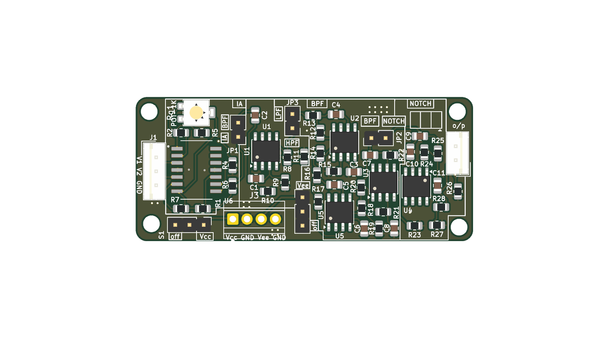
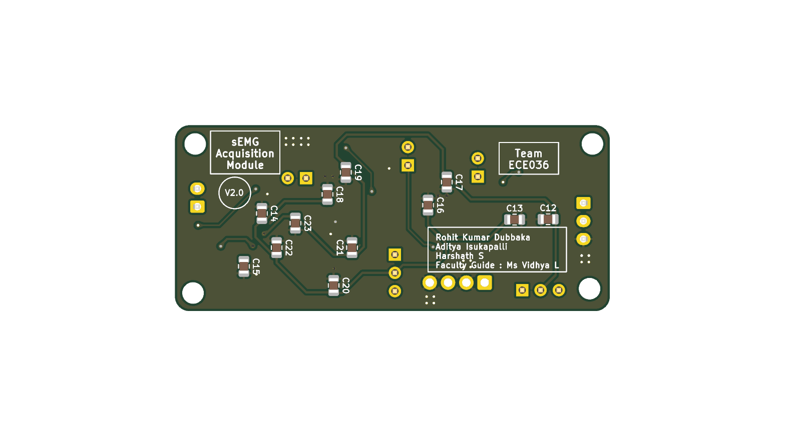
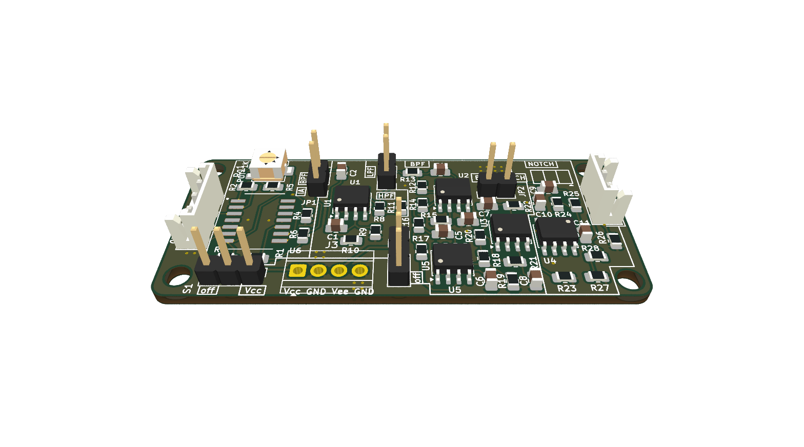

# sEMG_AFE_V2.1.kicad_pro

> Generated with export_fab_outputs.py v2.0.0

## 🚀 How to Use the Automation Script

### 🔧 Command Line (Terminal)

Run the following command **from the project directory** (where `.kicad_pro` is located):

```bash
make
```

To generate a zip of Gerbers for fabrication:
```bash
make release
```

Or run the script directly:
```bash
python3 scripts/export_fab_outputs.py
```

---

### 3D Views
#### Top View

#### Bottom View

#### Perspective View


---

### Schematic
[sEMG_AFE_V2.1.kicad_pro_schematic.pdf](output/sEMG_AFE_V2.1.kicad_pro_schematic.pdf)

### BOM
[sEMG_AFE_V2.1.kicad_pro_BOM.xlsx](output/sEMG_AFE_V2.1.kicad_pro_BOM.xlsx)

### Top Assembly
[sEMG_AFE_V2.1.kicad_pro_Top_Assembly.pdf](output/sEMG_AFE_V2.1.kicad_pro_Top_Assembly.pdf)

### Bottom Assembly
[sEMG_AFE_V2.1.kicad_pro_Bottom_Assembly.pdf](output/sEMG_AFE_V2.1.kicad_pro_Bottom_Assembly.pdf)

### Gerbers & Drill Files
[Gerbers/](output/Gerbers)

### Pick & Place
[sEMG_AFE_V2.1.kicad_pro-all-pos.csv](output/Gerbers/sEMG_AFE_V2.1.kicad_pro-all-pos.csv)

### Interactive BOM
Download and open [ibom.html](output/ibom/ibom.html) in browser
